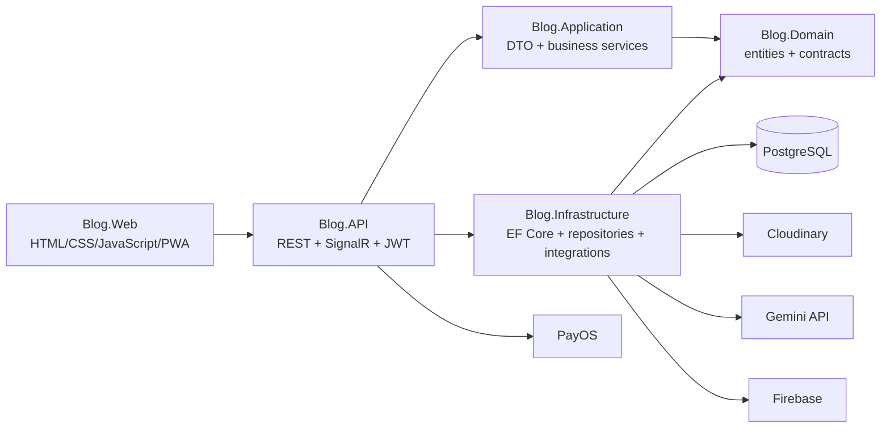
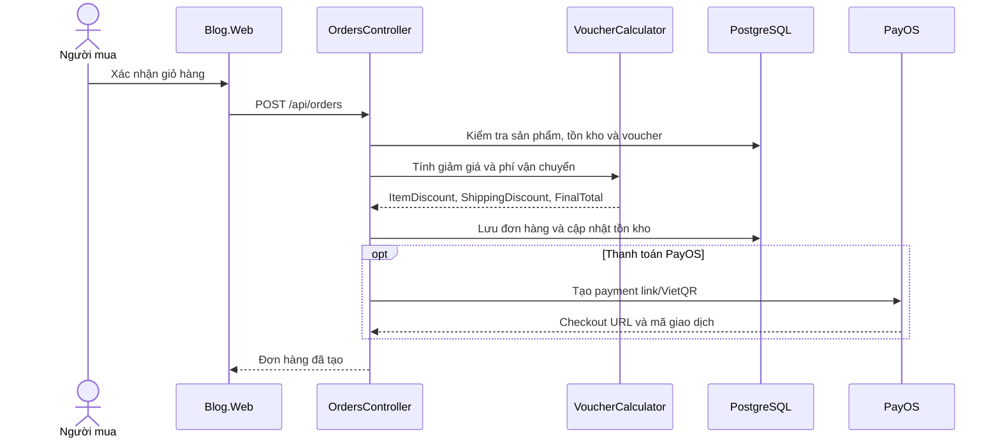
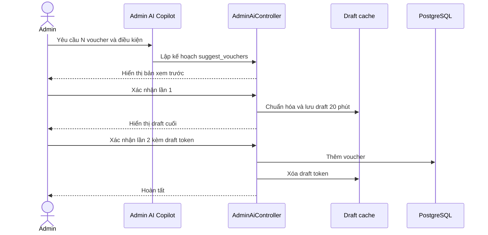

# Kiến trúc Zynk

## Tổng quan

## Trách nhiệm từng project

| Project | Trách nhiệm |
|---|---|
| `Blog.Domain` | Entity, enum và interface không phụ thuộc hạ tầng |
| `Blog.Application` | DTO và logic nghiệp vụ có thể kiểm thử độc lập |
| `Blog.Infrastructure` | EF Core, repository, PostgreSQL và dịch vụ bên ngoài |
| `Blog.API` | HTTP API, JWT, authorization, SignalR và composition root |
| `Blog.Web` | Giao diện người dùng, seller và admin |
| `Blog.Tests` | Automated tests cho nghiệp vụ quan trọng |

## Luồng đặt hàng

## Luồng Admin AI tạo voucher

## Realtime

- `ChatHub`: tin nhắn 1-1 và trạng thái hội thoại.
- `NotificationHub`: thông báo tương tác và mua sắm.
- JWT của SignalR được đọc từ `access_token` trên đường dẫn hub được cho phép.

## Deployment probes

| Endpoint | Mục đích | Thành công | Thất bại |
|---|---|---:|---:|
| `/health/live` | API process đang chạy | 200 | Không kết nối được process |
| `/health/ready` | PostgreSQL sẵn sàng | 200 | 503 |

Readiness không trả chi tiết exception hoặc connection string ra client. Lỗi kết nối được ghi qua application logger.

## Nguyên tắc bảo mật

- Secret được nạp từ environment variables hoặc `appsettings.Local.json` đã ignore.
- API nhạy cảm dùng JWT và role authorization.
- Tác vụ Admin AI có thay đổi dữ liệu yêu cầu xác nhận.
- Draft voucher AI gắn với Admin hiện tại, hết hạn sau 20 phút và chỉ dùng một lần.
- File upload và AI endpoint có giới hạn kích thước/tần suất ở tầng API.
